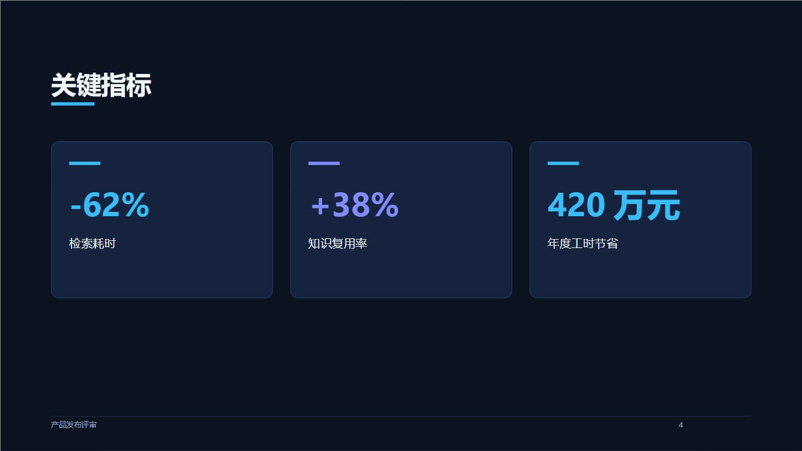
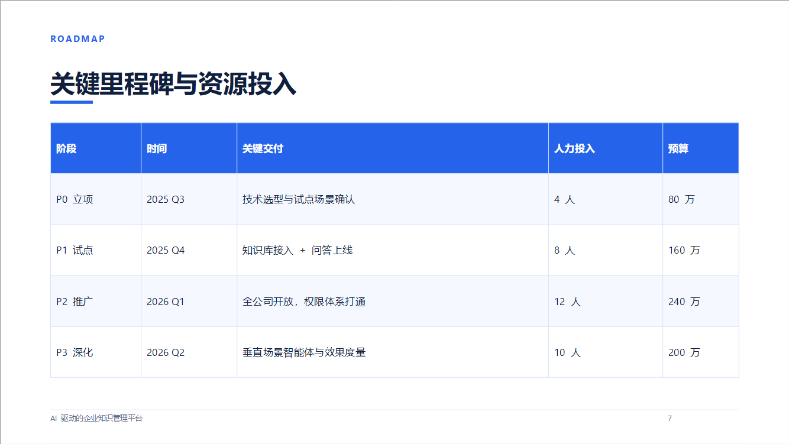

# PPT Studio · 自动生成演示文稿的网站

输入一个主题（或一段大纲 / 素材），自动排版成一套完整的 16:9 演示文稿，实时预览，一键导出**真正可用的 `.pptx`**。

**纯前端、零依赖、可离线。** 不需要安装任何东西，不需要联网，不需要 API Key。
打开 `index.html` 就能用，导出 PPT 全程在浏览器本地完成。


| 数据卡片 | 表格页 |
| --- | --- |
|  |  |

> 以上图片是把本站**导出的 .pptx 逐页渲染**的结果，不是设计稿——你看到的就是导出效果。
>
> 🌐 在线体验：https://zhengweilin142.github.io/ppt-studio/

---

## 快速开始

| 方式 | 做法 | 适合 |
| --- | --- | --- |
| 在线版 | 打开上面的 GitHub Pages 链接 | 只想马上试用 |
| 单文件版 | 双击 `dist/PPT-Studio.html`（运行 `node tools/bundle.js` 生成） | 想离线用、或要把网站发给别人 |
| 源码版 | 双击 `index.html`（保持 `js/` `css/` 在一起） | 想改代码 |

三种方式都直接跑在 `file://` 或静态托管上，无需后端、无需构建。
建议使用 Chrome / Edge 103+（能用浏览器原生压缩，文件更小）；其它浏览器会自动降级为无压缩打包，功能完全一样。

---

## 它能做什么

- **两种输入都能出片**
  - 只有主题 → 按场景模板（商业方案 / 产品发布 / 工作汇报 / 培训课程 / 调研综述 / 融资路演）搭出可直接填写的骨架；
  - 有素材 → 解析 Markdown 大纲、要点列表，甚至直接粘一段大白话，自动分页。
- **10 种版式**：封面、目录、章节过渡、要点页、两栏对比、数据卡片、表格、时间轴、金句、结尾页。
- **实时预览**：左侧改动，中间缩略图立刻更新；点缩略图可放大成单页；`←` `→` 翻页。
- **逐页微调**：右侧检查器可改标题、要点、指标、表格、备注；支持上移 / 下移 / 复制 / 删除 / 插入新页。
- **6 套配色主题**：深海商务、暗夜科技、极简墨白、森野绿、落日渐橙、紫罗兰。
- **放映模式**：全屏演示，`←` `→` 翻页，`Esc` 退出。
- **导出 `.pptx`**：16:9，文字均为可编辑的真实文本框，表格是原生 PPT 表格，**演讲者备注会写进备注页**。
- **可选接入大模型**：填入任意 OpenAI 兼容接口（DeepSeek / 通义 / Moonshot / 本地 Ollama…），让 AI 帮你把一句话主题扩展成完整大纲。不填也完全不影响使用。
- 自动保存草稿到浏览器本地（localStorage），也能直接编辑底层 JSON。

---

## 大纲语法

什么都不写也能用；写了就按你的结构来。

```markdown
# 文稿主标题                     ← 整个文稿的标题，只写一次

## 小节标题                      ← 一页内容页
- 一条要点
- 另一条要点
  - 缩进两个空格 = 二级要点

@stats                          ← 数据卡片页
- 检索耗时: -62%
- 复用率: +38%

@table                          ← 表格页（标准 Markdown 表格）
| 阶段 | 时间 | 关键交付 |
| --- | --- | --- |
| P0 立项 | 2025 Q3 | 技术选型 |

@timeline                       ← 时间轴页
- 2025 Q3: 完成技术选型
- 2025 Q4: 接入核心知识源
- 2026 Q1: 全员开放

> 一句话金句 —— 出处             ← 自动识别为金句页
```

可用指令：`@stats` `@table` `@timeline` `@quote` `@two-col` `@section` `@bullets` `@agenda` `@cover` `@closing`
`#` 一级标题会被当作章节，自动生成目录页与章节过渡页。

没有 Markdown 结构也没关系：连续段落会按「一段一页、首句作标题」自动分页，长句会按标点拆成要点。

---

## AI 设置（可选）

右上角「⚙ AI 设置」里填三项即可：

| 字段 | 说明 |
| --- | --- |
| Base URL | 以 `/v1` 结尾，如 `https://api.deepseek.com/v1` |
| API Key | 只保存在本机浏览器 localStorage，直接发给你填的接口地址 |
| 模型名 | 如 `deepseek-chat` |

有个「测试连通性」按钮可以先自检。

**设计取舍**：AI 只负责产出 **Markdown 大纲**，排版仍由本地引擎完成。好处是模型的输出永远不会破坏版式，生成的大纲还会写回左侧输入框，你可以接着手动改。

如果接口不支持浏览器跨域（CORS），浏览器会直接拦截请求——页面会给出明确提示，此时用本地模板引擎即可，功能不受影响。

---

## 目录结构

```
ppt-studio/
├── index.html              入口（源码版）
├── css/app.css             界面样式
├── js/
│   ├── themes.js           6 套配色主题
│   ├── layout.js           ★ 布局引擎：幻灯片数据 → 中立绘制指令
│   ├── zip.js              ★ 零依赖 ZIP 打包（CRC32 + deflate/stored）
│   ├── pptx.js             ★ 手写 OOXML：母版/版式/主题/表格/备注页
│   ├── engine.js           内容引擎：大纲解析 + 场景模板
│   ├── ai.js               可选的大模型接入
│   ├── preview.js          绘制指令 → HTML（保证预览 = 导出）
│   └── app.js              界面控制器
├── tools/                  构建与验证脚本（Node + Python）
└── dist/                   产物：单文件版 + 示例 pptx + 渲染预览图（不入库）
```

### 为什么预览和导出能保持一致

`layout.js` 把所有版式编译成一套**中立的绘制指令**（矩形 / 圆角块 / 椭圆 / 文本 / 表格，单位统一为英寸），然后：

- `pptx.js` 把指令翻译成 OOXML → `.pptx`
- `preview.js` 把指令翻译成 HTML/CSS → 网页预览

两边共用同一份排版结果，所以「网页上看到什么，导出就是什么」。字号也是同一套自适应算法算出来的（按中英文字宽估算行数，在给定盒子里挑最大能放下的字号），不会溢出。

---

## 技术实现要点

- **自研 OOXML 打包器**：手写 `[Content_Types].xml`、关系图、幻灯片母版/版式、主题、原生表格 `a:tbl`、以及 `notesSlide` 备注页；用自己实现的 ZIP 打包器（CRC32 + `CompressionStream('deflate-raw')`，不可用时降级为 store 模式）输出 `.pptx`。
- 文字是**真实可编辑的文本框**，不是图片；导出的文件可以用 PowerPoint / WPS / Keynote / LibreOffice 直接打开继续编辑。
- 不依赖任何 CDN、字体或网络资源。

---

## 验证情况

仓库里带了完整的验证脚本，都是可重跑的：

```powershell
node tools/smoke.js        # 内容引擎各分支 + 6 套主题导出，44 项断言
node tools/ui-test.js      # 无头跑整个前端：渲染/切主题/生成/翻页/编辑/增删/放映/导出，26 项断言
node tools/build-test.js   # 生成覆盖全部版式的样例 pptx
node tools/bundle.js       # 打包单文件版

python tools/validate.py dist/xxx.pptx --expect "某段文字"
# 校验包结构、内容类型、全部内部关系、python-pptx 复读内容

python tools/check-encoding.py
# 检查仓库内所有文本文件是否为干净的 UTF-8（无 BOM、无二次编码乱码）
```

当前状态：**smoke 44/44、UI 26/26、结构校验全部通过**，并已用 LibreOffice 把导出的幻灯片逐页渲染成图人工核对过排版。

> `tools/ui-test.js` 里带一个约 200 行的最小 DOM 垫片——因为没有可用的无头浏览器，就用它把整个前端按真实加载顺序跑起来，导出的 `.pptx` 走的是和「导出」按钮完全相同的代码路径。

---

## 已知限制

- 不支持插入图片、图表和动画（导出的都是矢量图形与文本；数据用卡片/表格/时间轴表达）。
- 中文字体默认用「Microsoft YaHei」，西文用「Segoe UI」。换到没有这些字体的系统上，会回退到系统默认字体。
- AI 功能依赖你自带的接口；接口若不允许跨域，浏览器会拦截（这是浏览器安全策略，不是本站限制）。
- 极端长的单条要点会被自动缩小字号，但不会自动断行到下一页，建议一条要点控制在一行半以内。
